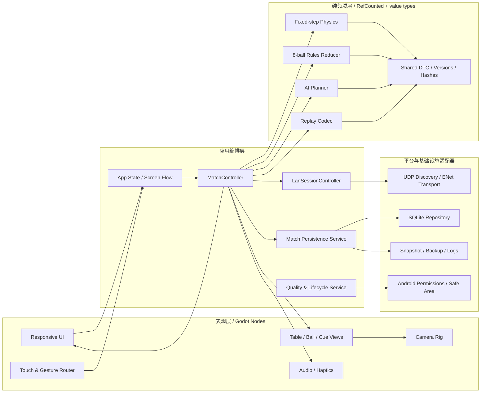

# 架构总览

## 1. 设计原则与审计承接

阶段 0 证明仓库只有文档，因此没有“保留现有运行时代码”的可行路径；本设计只保留需求、审计结论与阶段门禁。针对 R-01/R-02，所有运行验证均推迟到工具链就绪；针对 R-03/R-04，物理、规则、AI 与表现分层；针对 R-07/R-08/R-12，依赖、协议、schema 与回放均版本化；针对 R-10/R-11，先建立忽略规则与依赖证据台账。

核心约束：

- **单一权威状态**：本地由 `MatchController`、LAN 由主机侧的同一控制器拥有。
- **纯领域核心**：物理、规则、AI 不依赖场景树、UI、Android、文件系统或网络。
- **显式边界**：输入是命令，物理输出有序事件，规则输出新状态和决策，表现只读快照。
- **可复现但不夸大确定性**：记录版本、种子、步长和校验；主机权威避免跨端锁步要求。
- **依赖后置**：SQLite 扩展在真实 PoC 通过前只在适配器后方，不进入领域模型。

## 2. 模块与依赖图



允许的依赖方向为 `Presentation/Application → Core` 与 `Application → Adapters → Core DTO`。`Core` 不得反向引用任何 Node、Autoload、Android API、Socket、FileAccess 或 SQLite。物理与规则都依赖共享事件 DTO，而不是互相调用；AI 通过只读预测接口使用物理，物理不知道 AI。

## 3. 模块所有权

| 模块 | 只负责 | 明确不负责 |
|---|---|---|
| `AppController` | 启动、页面、暂停、恢复、服务生命周期 | 击球规则、逐球运动 |
| `MatchController` | 串行化命令、协调物理/规则/存储/回放 | 渲染、SQL、Socket 编解码 |
| `PhysicsWorld` | 固定 tick、碰撞、摩擦、落袋事件、最终球态 | 犯规、胜负、UI、动画 |
| `RulesReducer` | 纯状态迁移、犯规、球组、球权、胜负 | 改动物理世界、播放反馈 |
| `AiPlanner` | 合法候选、评分、难度扰动、种子流 | 直接设置球态、读取未来随机结果 |
| `LanSessionController` | 房间状态、重连、限流、主机/客户端角色 | 客户端自行裁决 |
| `MatchRepository` | 事务、迁移、查询、备份恢复接口 | 规则或 SQL 之外的领域判断 |
| `ReplayRecorder/Player` | 版本化快照/命令/事件/校验 | 用旧版本参数强行重算 |
| `Presentation` | 插值、镜头、布局、音效和触觉 | 复制或修改权威规则状态 |
| `PlatformService` | 权限、安全区、生命周期、能力 | 比赛逻辑 |

## 4. 目标场景树

以下是阶段 2 以后逐步实现的目标树，不是现有场景：

```text
root (Window)
├── App (Node)                              # 仅组合，不放规则
│   ├── Services (Node)
│   │   ├── SettingsService
│   │   ├── StorageService
│   │   ├── PlatformService
│   │   └── DiagnosticsService
│   ├── ScreenHost (Node)
│   │   └── MatchScreen (Control)
│   │       ├── WorldViewport (SubViewportContainer)
│   │       │   └── World (SubViewport)
│   │       │       ├── TableView (Node3D)
│   │       │       ├── BallViews (Node3D)
│   │       │       ├── CueView (Node3D)
│   │       │       ├── CameraRig (Node3D)
│   │       │       └── PresentationEffects (Node3D)
│   │       ├── HudSafeArea (MarginContainer)
│   │       │   ├── LandscapeLayout (Control)
│   │       │   └── PortraitLayout (Control)
│   │       └── InputRouter (Node)
│   └── OverlayHost (CanvasLayer)
│       ├── ModalHost
│       ├── ToastHost
│       └── DebugOverlay
```

自动加载只允许应用级服务与启动组合；`PhysicsWorld`、`RulesReducer`、`MatchState`、`AiPlanner`、LAN 房间和回放对象必须随比赛创建/销毁，禁止成为全局单例。UI 不保存第二份球组、球权或胜负，只保存短期控件/手势状态。

## 5. 目标目录结构

```text
project.godot                             # 阶段 2 才创建
export_presets.cfg                        # 无密码，阶段 2 经实测生成
src/
├── app/                                  # 启动、页面、比赛编排、生命周期
├── core/
│   ├── model/                            # DTO、枚举、版本、规范化与哈希
│   ├── physics/                          # 无 Node 的固定步进世界
│   ├── rules/                            # 8 球 reducer 与规则配置
│   ├── ai/                               # 候选、评分、走位、难度和种子
│   └── replay/                           # 格式、校验、快照播放
├── adapters/
│   ├── storage/                          # SQLite repository、迁移、备份
│   ├── network/                          # UDP/ENet、codec、房间传输
│   └── platform/                         # 权限、安全区、设备能力
├── presentation/
│   ├── table/                            # 球桌/球/球杆视图
│   ├── camera/
│   ├── input/
│   ├── ui/
│   └── effects/
└── diagnostics/
assets/{models,materials,textures,audio,fonts,localization}/
config/{physics,rules,ai,quality}/        # 版本化 Resource/只读配置
tests/{unit,integration,fixtures,performance,device}/
addons/godot-sqlite/                      # PoC 通过且批准后固定版本引入
android/                                  # 仅必要的 Gradle/插件定制
build/                                    # 忽略，不入库
docs/
```

依赖方向通过目录可见性与代码评审检查；领域层测试不得加载 `src/adapters` 或 `src/presentation`。

## 6. 单次击球数据流

```mermaid
sequenceDiagram
    participant Actor as Human / AI / LAN Client
    participant MC as MatchController (host authoritative)
    participant V as ShotValidator
    participant P as PhysicsWorld
    participant R as RulesReducer
    participant S as Storage + Replay
    participant UI as Views / LAN peers

    Actor->>MC: ShotCommand + match/turn/shot IDs
    MC->>V: validate phase, owner, type, range, rate
    V-->>MC: accepted canonical command / rejection
    MC->>P: apply at tick boundary and fixed-step
    P-->>MC: ordered PhysicsEvent[] + final BallState[] + checksum
    MC->>R: reduce(pre-state, command, events, final layout)
    R-->>MC: new MatchState + RuleDecision + domain events
    MC->>S: one shot-boundary transaction
    S-->>MC: commit / explicit failure
    MC-->>UI: authoritative snapshots and events
```

所有写入在 shot 边界串行提交。存储失败不得让 UI 先宣称结果已保存；运行态与持久态的错误策略见数据文档。网络客户端只收到主机接受/拒绝和权威结果，不能提交 `RuleDecision`。

## 7. 生命周期与失败边界

- 暂停：停止接收新击球、冻结表现、保存最近完整 shot 边界；不得在半次规则裁决后提交。
- 后台恢复：重新查询权限、网络、窗口、安全区和音频状态，不能沿用缓存。
- 主机退出：本版本结束房间；不做主机迁移，提供最近完整边界用于新建房间恢复。
- 物理不收敛：进入可诊断错误，不猜测胜负，不继续接受命令。
- 数据损坏：隔离原文件并尝试已校验备份；不得静默清空用户数据。
- 版本不兼容：加入前拒绝；回放只允许明确支持的路径。
