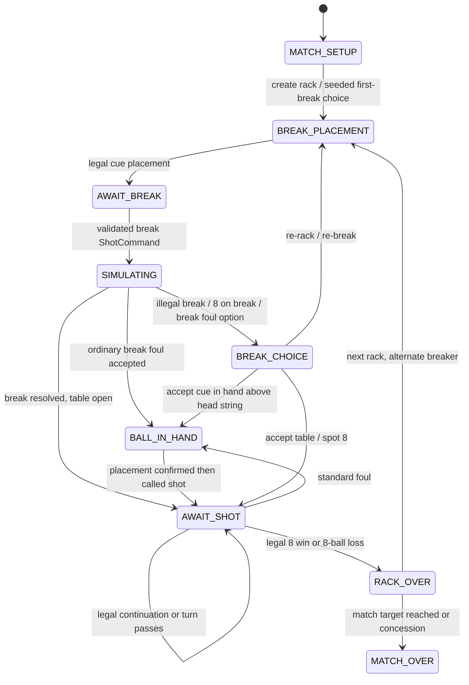
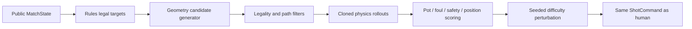

# 美式 8 球规则与五档 AI

## 1. 规则基线和数字化边界

默认规则标识为 `WPA_2026_DIGITAL_V1`，依据 WPA《Rules of Play》2026-10-21 的通用规则和第 4 节 8-Ball。规则文本是规格来源，`RulesReducer` 是唯一机器裁决者；配置只能启用已实现的变体，不能悄悄混入酒吧规则。

明确数字化差异：

- 不检测脚部触地、触碰球、推杆、双击球杆、球杆模板、慢动作裁判、不当行为或外部干扰；这些依赖现实观察，不能伪造传感器结论。
- 2.5D 不提供跳球和真实球杆接触输入；不支持的杆法在命令校验时拒绝。
- 首局开球权使用房间创建时记录的透明随机抽签及 seed，抽签胜者可选择自己或对方先开球；这是现实 lag 的数字化替代，不宣称等同竞赛程序。后续 rack 轮换开球，轮换顺序写入比赛状态。
- 默认不使用三次连续犯规判负；WPA 通用规则明确 8-Ball 不包含该条。后续若新增房间变体必须使用不同 `rules_version` 和独立测试。
- 无自动慢赛犯规；房间可选操作超时只触发断线/放弃控制策略，不伪装成 WPA 裁判判罚。
- 数字球袋以捕获几何事件为准；袋口悬球、静置五秒后落袋等现实裁判细则需要专门模型，首版不宣称完整模拟。

官方规则证据和 URL 见 [技术证据](09-technology-evidence.md)。

## 2. 状态与不变量

`MatchState` 至少包含：

```text
rules_version, match_id, rack_number, phase
players[2], shooter, breaker, first_break_seed
open_table, groups[player], ball_status[1..15]
cue_ball_disposition, cue_in_hand, placement_region
called_ball, called_pocket, safety
pending_choice, winner, losing_reason, turn_serial, shot_serial
```

不变量：

1. 同一球只处于 `ON_TABLE / POCKETED / OFF_TABLE` 之一；1–7 与 9–15 互不重叠，8 独立。
2. `open_table=true` 时双方组均为 `UNASSIGNED`；分配后两组互补。
3. 只有 `AWAIT_SHOT/BALL_IN_HAND/AWAIT_BREAK` 接受新击球；`SIMULATING` 中只接受控制命令。
4. 任一时刻最多一个 `pending_choice`；选项只能由指定玩家提交，且附带预期 `turn_serial`。
5. `RACK_OVER` 后不再推进物理；开始下一 rack 必须创建显式命令并轮换 breaker。
6. reducer 只从已静止的 `ShotResult` 和击球前状态计算，不根据 UI 文案或动画推断结果。

## 3. 状态机



`AWAIT_SHOT` 图中包含 shooter 改变；实现必须使用显式新状态而不是原地修改。任何阶段都可进入 `SUSPENDED`；恢复原阶段需要已提交快照。`TECHNICAL_ERROR` 不是犯规或终局，禁止借此给任一方胜利。

## 4. 击球前验证

| 输入 | 必要验证 |
|---|---|
| 开球 | 当前玩家是 breaker；母球在 Head String 上方的严格开放区域；不叫球、不叫袋；类型和数值有限 |
| 开放球桌普通击球 | 首叫目标不得为 8，除非该方已合法清空可主张球组的数字化边界场景；叫球与叫袋成对出现 |
| 已分组 | 叫球属于己方且在台；己方未清空前不得以 8 为首碰/叫球 |
| 打 8 | 击球前己方组球已全部落袋；必须叫 8 与目标袋 |
| Safety | `safety=true`，`called_ball/called_pocket` 为空；合法后无论是否进球都交换球权 |
| 手中球 | 放置区域符合普通全场或开球/特定开球犯规的 Head String 限制；不与球重叠，不在袋捕获区或库边实体中 |
| 通用 | `match_id/turn_serial/shot_id/seat` 匹配，有限数值，power/杆点在范围内，未在运动中 |

开放球桌允许首先接触除 8 外任何目标球。普通击球首碰合法并不等于整杆合法，仍需检查碰库、母球落袋、目标球出界等事件。

## 5. 事件归约和裁决顺序

每个 shot 构造只读 `ShotFacts`：

```text
first_object_ball
object_ball_contacts[]
rail_contacts_after_first_object[]  # 包含落袋/出界的 rail 语义映射
unique_object_balls_driven_to_rail_on_break
pocketed[] (ball_id, pocket_id, event_sequence)
off_table[]
cue_scratch, cue_off_table
called_ball_pocketed_in_called_pocket
termination
```

裁决按以下顺序，所有原因同时保留为 `reason_codes`，但只应用最高严重度结果：

1. **技术有效性**：非 `AT_REST`、缺首碰事件或状态版本不符，进入技术错误，不做胜负裁决。
2. **开球专用分支**：依次处理 8 号球、目标球出界、其他犯规、无进球且少于四个目标球碰库的非法开球，以及合法继续。
3. **非开球 8 号球严重结果**：8 落袋且犯规、提前落袋、落入未叫袋、8 出界均判当前 shooter 输；合法清空本组后叫对球和袋且无犯规则赢。
4. **普通犯规**：母球落袋/出界、错误首碰、无球落袋且首碰后无任何球碰库、目标球出界、非法放置等；对手获得全场手中球。
5. **Safety**：若无其他犯规，交换球权；已落袋目标球保持落袋，不因 safety 复位。
6. **开放球桌分组**：合法叫球进入叫袋则分配对应组；否则仍开放。开球落袋不分配组。
7. **连续击球**：已分组时，合法击入己方球可继续；开放球桌合法叫球入袋并分组后可继续；否则交换球权。
8. **下一状态**：更新球态、球权、手中球和 serial；其他目标球在非开球出界保持出界，只有规则指定的 8 在开球可重置。

WPA 对“近似同时首碰且无法分辨”有有利合法目标的裁判约定；数字物理若事件在容差内不可区分，应采用相同确定性的有利规则并记录 `AMBIGUOUS_FIRST_CONTACT_RESOLVED_LEGAL`，不能按数组顺序武断判犯规。

## 6. 开球选择表

| 情形 | 选择所有者与选项 |
|---|---|
| 无目标球落袋且少于 4 个目标球碰库，未另有更严重结果 | incoming player：接受当前球桌；重摆并由自己开球；重摆并让对方再开球 |
| 合法开球中 8 落袋 | breaker：重置 8 并接受球桌；重摆再开球 |
| 开球犯规且 8 落袋 | opponent：重置 8，并在 Head String 上方手中球；重摆并由自己开球 |
| 开球目标球出界 | 出界球保持出界，8 除外；incoming player：接受球桌；Head String 上方手中球 |
| 其他开球犯规 | incoming player：接受球桌；Head String 上方手中球 |
| 合法开球有球落袋 | breaker 继续，球桌仍开放，不自动分组 |

“接受”与“重置/重摆”均由 `BreakChoice` 驱动；UI 不直接修改球。重置 8 使用 WPA 的 Long String/Foot Spot 就近规则，若被阻挡按顺序向 Foot Rail，再向反方向寻找合法位置；所有位置通过碰撞与边界校验。

## 7. 规则测试矩阵

| ID | 最小场景 | 必须断言 |
|---|---|---|
| RULE-B01 | 开球合法进球 | 继续、开放、未分组 |
| RULE-B02 | 无进球且 3/4 个不同目标球碰库 | 3 个产生非法开球选择，4 个不产生 |
| RULE-B03 | 合法/犯规开球中 8 落袋 | 选项所有者和球区域正确，不直接判胜负 |
| RULE-B04 | 开球目标球出界 | 普通球不复位，8 复位，选择正确 |
| RULE-G01 | 开放桌叫球合法入袋 | 只分配对应组，非叫球落袋不另分组 |
| RULE-G02 | 开放桌未叫中 | 保持开放并交换球权 |
| RULE-G03 | 分组后首碰对方球/8 | 错误首碰，对手全场手中球 |
| RULE-G04 | 首碰后无碰库且无进球 | `NO_RAIL_AFTER_CONTACT` |
| RULE-G05 | Safety 合法进球 | 球保持落袋，交换球权，不分配错误组 |
| RULE-E01 | 清空本组、叫 8 叫袋且合法 | 当前玩家获胜 |
| RULE-E02 | 提前 8、错袋 8、8 出界、8 落袋并犯规 | 当前玩家输，开球除外 |
| RULE-E03 | 同杆多原因 | 严重 8 结果优先，原因完整且只迁移一次 |
| RULE-C01 | 重复 choice/command、过期 serial | 幂等返回或明确拒绝，不双重重摆 |
| RULE-C02 | 手中球区域/重叠/线上 | 合法区域和边界定义一致 |
| RULE-X01 | 非静止、NaN、缺事件 | 技术错误，不产生胜负 |
| RULE-X02 | 同状态同事件重复 reduce | 深层相等，无全局状态或时钟依赖 |

测试fixture直接构造最小 `MatchState` 和 `ShotResult`，无需场景树；另用属性测试生成球态和事件排列，检查球组互补、8 结果唯一、重复命令不迁移。

## 8. AI 决策流水线



1. **候选生成**：对合法目标球和六袋计算 ghost-ball 位置、瞄准角和切角；手中球另生成有限合法放置候选。
2. **几何过滤**：排除目标球路径/母球到 ghost 点路径被阻挡、袋口 jaw 不可达、切角超过配置范围、明显无解的力度区间；不能删掉所有候选后无解释失败。
3. **克隆 rollout**：使用同一 `PhysicsPredictor` 和配置，在只读副本上模拟有限候选；输出进球、犯规、下一杆几何和 risk 摘要。预测绝不修改权威世界。
4. **评分**：合法进球价值、8 胜负、母球/目标出界风险、下一目标可达性、走位、safety 价值；难度只改权重、候选数、采样数和误差，不改规则。
5. **扰动**：在选定名义解上施加角度、力度和杆点误差，最终扰动后的 `ShotCommand` 写入回放；seed stream 与 rack/shot/attempt 派生，避免调用顺序改变全局随机结果。
6. **降级**：无进攻候选时生成安全击球；仍无合法解则选择最小风险合法命令并附诊断，不能跳过回合或摆球作弊。

## 9. 五档初始能力参数

以下是**待实测校准的初始配置**，不是已验证强度或胜率：

| 档位 | 瞄准正态误差 σ | 力度相对误差 σ | 名义候选上限 | 每候选 rollout | 走位评估 | 风险模型 |
|---|---:|---:|---:|---:|---|---|
| 1 入门 | 2.50° | 18% | 4 | 0 | 无；随机可达候选 | 忽略多数犯规/落袋风险 |
| 2 休闲 | 1.20° | 10% | 8 | 1 | 当前进球 + 粗略下一目标距离 | 明显母球落袋 |
| 3 标准 | 0.55° | 5% | 16 | 4 | 下一杆几何评分 | 首碰、无碰库、母球风险 |
| 4 熟练 | 0.22° | 2.5% | 32 | 16 | 下一杆 + safety 比较 | 完整事件风险与力度敏感性 |
| 5 专家 | 0.08° | 1.0% | 全部合法几何候选，最多 64 | 64 | 两杆浅搜索，分支上限 8 | 多扰动分布与 8 胜负约束 |

- 误差使用版本化、独立种子的有界正态近似；采样后重新规范化，超范围裁切并记录，不能无限重抽制造“幸运结果”。
- 高难仍有非零误差，低难也通过同一合法命令链；不为低难故意犯规，不为高难改碰撞或落袋。
- 计算预算按候选和 rollout 数量确定，避免不同设备因 wall-clock 截断而选出不同候选。后台 worker 只接收不可变上下文并返回结果；销毁比赛时取消并拒绝迟到结果。
- 难度胜率和“像真人”必须在阶段 5 通过固定对局集、人机测试和统计区间校准，不能用参数表代替。

## 10. AI 验证

- 五档各 1000 个固定 seed 命令：范围、首碰目标、叫球/叫袋和 serial 均合法。
- 同一上下文和 seed 重跑输出一致；权威世界与 RNG 状态在规划前后不变。
- 注入无法进球的 layout，AI 仍能给出 safety 或结构化 `NO_LEGAL_CANDIDATE`，不修改球态。
- 比较候选覆盖率、瞄准/力度误差分布、犯规率、进球率、平均走位得分和计算时间；不只比较总分。
- 回放只播放最终命令，因此 AI worker 快慢不影响比赛事实；AI 自身 seed/版本仍保存用于审计。
- Android 与桌面分别记录耗时和内存；没有设备数据前，不宣称五档可实时运行。
