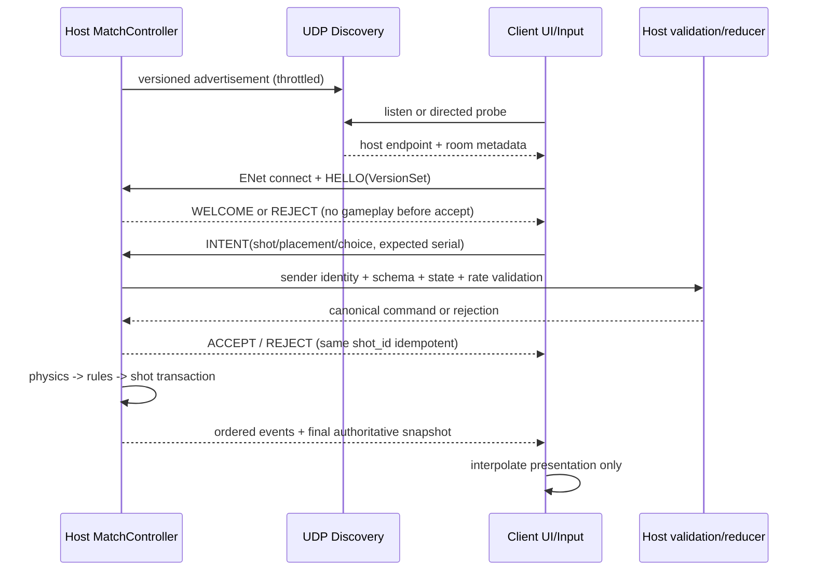

# LAN 主机权威与协议草案

## 1. 范围与信任模型

支持同一可信 LAN 内一名主机和一名客人进行双人 8 球；不提供互联网匹配、公共服务器、NAT 穿透、账号、 spectators 或主机迁移。主机运行与单机完全相同的 `MatchController`、物理、规则和存储，客户端只发送放置/击球/选择意图。

LAN 不等同安全网络：协议防止畸形输入、越权操作和意外状态冲突，但不承诺抵抗主机作弊、ARP/IP 欺骗、窃听或拒绝服务。房间码只降低误加入，不是身份凭据；首版不宣称传输加密。若将来需要不可信网络安全，必须另立 ADR，而不是把 SHA-256 校验当认证。

## 2. 技术选型

- **发现**：`PacketPeerUDP` IPv4 广播，固定原始字节包；默认只广播，不先引入 mDNS/Android 原生插件。 directed join 允许用户输入主机 IP，作为广播被 AP 隔离时的降级。
- **会话**：`ENetMultiplayerPeer`，UDP 承载，2 个显式 channel；可靠有序控制通道与 unreliable ordered 表现快照通道。规则、命令接受、选择、重连和最终 shot 结果全走可靠通道。
- **数据面**：`SceneMultiplayer.send_bytes/peer_packet` 传固定 schema envelope；保持 `allow_object_decoding=false`，不接收 Variant/Object。Godot 高层协议不是稳定公共线协议，因此本项目 envelope 仍自行版本化。
- **身份**：授权使用接收上下文中的 remote peer ID；payload 的 seat 只能交叉检查。`session_id + client_instance_id + reconnect_token` 用于重连绑定，token 使用随机值，不写入日志。

选择依据、备选与验证见 [ADR-004](adr/ADR-004-lan-host-enet.md)。

## 3. 拓扑与数据流



客户端可本地显示瞄准预览，但不得预跑并提交物理结果。主机玩家和 AI 也通过同一 canonical command 入口，避免三条规则路径。

## 4. 端口与生命周期

| 用途 | 初始约定 | 备注 |
|---|---|---|
| 发现监听 | UDP `49741` | 待端口冲突与双设备实测；创建房间可改配置 |
| ENet 会话 | UDP 动态可用端口，写入 advertisement | 避免与发现固定端口耦合；防火墙只限本地专用网络提示 |
| 广播间隔 | 初始 1 s | 待功耗/发现延迟实测，不是最终性能参数 |
| 房间容量 | 1 host + 1 guest | 其他连接在认证前拒绝 |

端口只在用户创建/加入房间后打开，离开立即关闭。Android 在权限授予前不创建 UDP/ENet socket。Wi-Fi 改变、应用后台或权限撤销后使旧 endpoint/session 失效，回到显式恢复流程。

## 5. Envelope v1

所有整数使用 little-endian、无符号除非字段另有说明；浮点使用 IEEE-754 binary64，发送前检查 finite。字符串 UTF-8 且带字节长度；数组带元素数；读取器先验证长度再分配，拒绝尾随字节和非规范编码。

```text
EnvelopeHeader
  magic              4 bytes = "RP3D"
  protocol_major     u16 = 1
  protocol_minor     u16 = 0
  message_type       u16
  flags              u16 (reserved = 0)
  header_bytes       u16
  payload_bytes      u32
  session_id         16 bytes (all zero only during discovery/HELLO)
  match_id           16 bytes (all zero when not applicable)
  message_sequence   u64 (per reliable session direction)
  ack_sequence       u64 (diagnostic/resume, not app-level delivery)
  turn_serial        u64
  shot_serial        u64
  payload            exactly payload_bytes
```

建议初始上限：发现包 512 B；普通控制 envelope 16 KiB；全量恢复 bundle 分块，每块 32 KiB，逻辑总量 2 MiB；最终数字必须在实现压测后调整。任何超限、非法枚举、NaN/Inf、重复字段、长度溢出、尾随数据都拒绝并计数，不能截断后继续执行。

### 消息类型

| 类别 | 类型 | 方向与语义 |
|---|---|---|
| 会话 | `HELLO, WELCOME, REJECT, PING, PONG, GOODBYE` | 版本、能力、心跳和显式退出 |
| 房间 | `ROOM_STATE, PLAYER_READY, MATCH_CONFIG` | 主机发布房间和固定配置 |
| 意图 | `SHOT_INTENT, PLACEMENT_INTENT, BREAK_CHOICE_INTENT, CONCEDE_INTENT` | guest → host，绝不包含裁决 |
| 回执 | `INTENT_ACCEPTED, INTENT_REJECTED` | 包含 `shot_id/client_nonce` 和稳定错误码 |
| 权威 | `SHOT_STARTED, PHYSICS_EVENT_BATCH, SHOT_COMMITTED, MATCH_SNAPSHOT` | host → guest，严格序列 |
| 恢复 | `RESUME_REQUEST, RESUME_BEGIN, RESUME_CHUNK, RESUME_END, RESUME_ACK` | 重连全量同步 |
| 控制 | `PAUSE_NOTICE, HOST_CLOSING, ERROR_NOTICE` | 不代替权威状态 |

`VersionSet` 包含 app、Godot、physics、rules、protocol、schema、replay。`protocol_major`、physics/rules major 或必要能力不一致时加入前拒绝；minor 只在双方声明可选能力交集后继续，不假定“相近版本兼容”。

## 6. 发现包

发现与 ENet envelope 分离，采用短二进制 `RP3D` magic、discovery version、message kind、length、session/room ID、ENet port、房间名长度、协议/规则/物理 major/minor、房间状态和随机 challenge。默认不广播玩家真实姓名、设备唯一 ID、IP 列表或持久标识。

- 主机 advertisement 和客户端 probe 都限长、限速；收到来源后交叉检查 UDP source IP/port 与 advertised ENet endpoint。
- 房间码参与 join proof 的 keyed hash 挑战，防止明文直接广播房间码；这只用于误加入控制，不防离线暴力或主动攻击。
- 客户端展示发现的版本和房间名，用户确认后才连接；重复 advertisement 以 `(source_ip, session_id)` 去重并更新 liveness。
- directed join 跳过广播，不跳过 HELLO、版本和房间验证。

## 7. 主机校验与幂等

接收顺序：传输来源 → envelope 结构 → session/match → 消息允许方向 → remote peer 与 seat 绑定 → phase/serial → 字段范围 → 频率 → canonicalize → shot 幂等。

| 字段/行为 | 主机规则 |
|---|---|
| `aim_angle` | finite；规范到 `[0, 2π)`；拒绝异常 magnitude |
| `power` | finite 且 `[0,1]`；最小非零力度由配置验证 |
| `cue_offset_x/y` | finite，归一化杆点向量不超过配置半径；不支持跳球标志 |
| `called_ball/pocket/safety` | 类型、枚举和互斥关系正确，规则状态允许 |
| `seat` | 必须等于 remote peer 当前绑定座位；不可代对方选择或认输 |
| `turn_serial/shot_serial` | 必须匹配当前预期；旧消息返回旧回执或 `STALE_TURN` |
| `shot_id/client_nonce` | 同一客户端同一 ID 重发返回缓存结果；不同内容复用同 ID 则拒绝并记录 |
| 频率 | 每 peer token bucket；超限返回 `RATE_LIMITED`，持续畸形包可断开 |

数据库 `(match_id, shot_ordinal)` 唯一约束与内存 shot cache 形成两层幂等。应用层收到 `INTENT_ACCEPTED` 不代表已提交；只有 `SHOT_COMMITTED` 才表示 shot-boundary 事务成功。

## 8. 快照与同步

- **控制/最终状态**：可靠有序，含 `turn_serial/shot_serial/state_revision/state_hash`；客户端只接受当前 session 中 revision 前进的快照，恢复流程除外。
- **表现快照**：unreliable ordered，只含球位置/旋转表现和 tick，可在模拟期间丢弃旧帧；不参与规则。带宽不足时首先降低此通道频率。
- **事件**：可靠通道按 `(shot_id, sequence)` 排序，客户端用于音效/轨迹；乱序到达先缓冲，缺口超时则请求权威快照，不能自行补事件。
- **哈希**：仅诊断，不允许客户端哈希覆盖主机。分歧时客户端丢弃本地表现推测并请求全量快照。

## 9. 重连、超时和主机退出

心跳和超时时长初始值只能标为待实测：建议 ping 2 s、连接空闲 10 s 进入 reconnecting、保留座位 60 s；不是已验证配置。暂停时停止比赛命令，但保持会话心跳。

1. 客户端保存 `session_id/client_instance_id/reconnect_token` 与最后已确认 revision，不保存可替代主机裁决的权威副本。
2. 重连是新的 ENet 连接和 HELLO；主机验证 token、座位保留和版本，作废旧 peer 绑定。
3. 主机从最近完整 shot 边界构造 `ResumeBundle`：配置、版本、完整 MatchState、球态、必要事件索引和 revision。
4. 分块带 `chunk_index/total/sha256`，全部收到后验证再原子替换；中途失败保持旧页面并允许重试，不应用半个 bundle。
5. 恢复后重发已提交命令只返回已有回执；模拟中断线时主机完成当前 shot，重连以最终快照为准。
6. 主机退出/崩溃不迁移权威；房间明确结束。若最近完整边界已持久化，可经双方确认在新房间恢复，生成新 session，原网络回执不跨 session 使用。

## 10. Android 权限与降级

目标 API 37 时需 `INTERNET` 和声明/运行时请求 `android.permission.ACCESS_LOCAL_NETWORK`；它属于附近设备权限组。首次进入 LAN 页面解释用途后请求，授权前 socket 不启动；拒绝/撤销展示离线可用入口和设置指导，不循环弹窗。

首选 Godot `OS.request_permission(full_name)` 与导出权限声明。只有真实 API 37 设备证明无法声明、请求或接收结果时，才评估最小 Android v2 插件。广播被禁用时可 directed IP join；若系统权限阻止全部 LAN，则无绕过方案，应诚实显示不可用。

## 11. 安全与异常测试

| 类别 | 必测注入 | 预期 |
|---|---|---|
| 编解码 | 截断、超长、尾随、非法 UTF-8、NaN、未知类型 | 有界内存、稳定错误，不崩溃不执行 |
| 身份 | 伪造 seat/peer、对方 choice/concede | 以 sender ID 拒绝 |
| 状态 | 运动中击球、过期 turn、错误口袋/球组 | 不推进物理/规则 |
| 重复 | 同 shot 同内容、同 shot 不同内容 | 前者幂等，后者拒绝 |
| 网络 | 丢包、重复、延迟、乱序、带宽限制 | 可靠控制最终一致，无客户端裁决 |
| 恢复 | 各 chunk 断线、错误 hash、重复 resume | 原子恢复或显式失败 |
| 生命周期 | 后台、Wi-Fi 切换、权限撤销、主机退出 | 会话失效清晰，不幽灵击球 |
| 资源 | 广播 flood、大量半开连接、大包 | 限速/拒绝，内存有界 |

这些均需要 Godot 和双进程/双设备测试；当前状态为 `BLOCKED`，不能用 Python codec 测试替代 Godot ENet/Android 证据。
