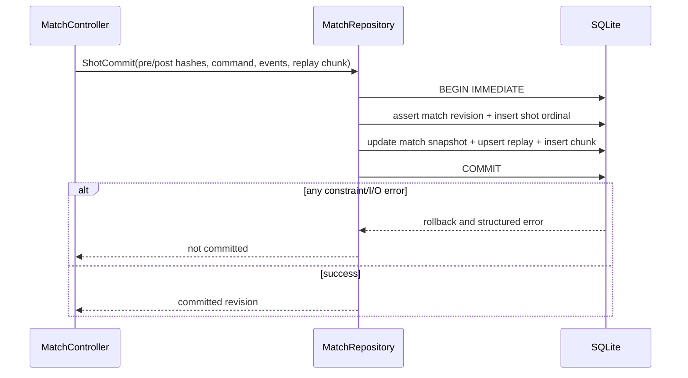

# SQLite 数据模型、回放与恢复

## 1. 依赖边界与数据所有权

数据访问只经 `MatchRepository` 和 `SettingsRepository` 接口；物理、规则、AI、UI 和 LAN 不直接执行 SQL。首选候选 `2shady4u/godot-sqlite v4.9` 仍未引入仓库，桌面/Android PoC 通过前不得成为正式运行依赖。

数据库位于 Godot `user://` 应用私有目录，默认文件名 `real_pool.sqlite3`。不存账号、云同步、签名密钥、LAN token 明文或敏感个人资料。昵称等用户文本也应最小化并可清除；诊断导出需用户主动选择。

## 2. Schema v1

完整可执行草案见 [schema_v1.sql](validation/schema_v1.sql)。表职责：

| 表 | 一行代表 | 关键约束/用途 |
|---|---|---|
| `schema_migrations` | 已应用迁移 | 版本、文件名、SHA-256、时间；与应用 `user_version` 一致 |
| `settings` | 一个规范设置键 | JSON 值、值版本、更新时间；白名单键和范围由应用验证 |
| `matches` | 一场比赛/rack 聚合上下文 | 模式、玩家、规则/物理/协议版本、状态、当前完整快照、创建/结束时间 |
| `shots` | 一次已提交击球/选择边界 | `(match_id, ordinal)` 唯一、shot UUID 唯一、命令和事件 JSON、前后 hash |
| `replays` | 回放索引 | 初始快照、版本集、最终状态、状态、计数；不塞大事件 BLOB |
| `replay_chunks` | 一段规范二进制回放数据 | `(replay_id, ordinal)` 唯一、每块 SHA-256，按需读取 |
| `training_attempts` | 一次训练尝试 | 任务/配置版本、命令、指标 JSON、seed；不污染正式战绩 |

UUID 使用 32 字符小写十六进制；时间使用 UTC ISO-8601 文本，仅作展示/排序辅助，比赛推进使用整数 serial/tick。JSON 只用于有版本的结构化记录，查询筛选字段必须独立成列；SQL 值全部参数绑定。

`matches.current_snapshot` 是最近完整 shot 边界的权威恢复点，包含 MatchState 与 BallState，不能只存 UI 摘要。战绩从 `matches/shots` 查询派生，不维护可漂移的第二份胜负计数。

## 3. 事务边界



- 单写者队列按比赛顺序执行；物理和规则不在 SQL 回调中运行。
- `shots.ordinal` 从 0 或 1 选定后固定，草案使用 1 起始；客户端提供的 UUID 用于幂等查找，数据库 ordinal 防止重复推进。
- 一次事务同时提交 match 新快照、shot、回放索引和对应 chunk。任何一步失败都回滚，UI 不得先显示“已保存”。
- 只有物理确认 `termination=AT_REST` 的合法 shot 才能进入该事务；`NON_CONVERGENCE`、`ABORTED` 和非法状态只写独立诊断/错误报告，不作为正常 shot 提交。`shots.termination` 的 SQL 约束是最后一道防线。
- 写库失败时保留当前内存比赛并进入显式 `PERSISTENCE_ERROR`，允许重试相同 commit；不能悄悄降级成 JSON/内存假成功。继续不保存的新比赛必须由用户明确选择。
- 启动和每次打开执行 `PRAGMA foreign_keys=ON`，并验证；journal/synchronous 模式需 Godot 插件真实支持后确定，不凭 Python 结果承诺插件行为。
- 查询分页有上限，BLOB 按 chunk 读取；AI/网络回调不持有跨线程 SQLite connection。

## 4. 迁移策略

1. 首次建库在同一个 bootstrap 流程执行 v1 schema、写入 `(version=1, script_name, sha256, applied_at)` 基线记录并提交；随后校验 `PRAGMA user_version=1` 与唯一基线记录完全一致，不能只设置其中之一。
2. 打开已有数据库后读取 `PRAGMA user_version`、迁移表和 integrity 状态；三者不一致时停止自动写入。
3. 仅允许 `N → N+1` 的顺序迁移，迁移脚本有固定文件名、预期旧版本和 SHA-256；不直接跳过一个未知版本。
4. 迁移前建立一致性备份；在事务中执行 DDL/DML、数据计数/外键/关键不变量验证、写入迁移记录和 `user_version`。
5. 失败回滚并保留原文件，提供恢复导出；不删除“看起来旧”的数据。
6. 高于当前支持的 `user_version` 为只读/拒绝打开，不能降级重写。
7. 每个迁移必须有旧版本 fixture，覆盖重复执行、空库、部分迁移、未来版本、磁盘空间不足和 Android 应用升级。

Python 探针用 `executescript()` 隔离验证草案，不能据此推断 godot-sqlite 的隐式事务行为。生产 bootstrap/迁移必须在插件 PoC 中验证显式事务、DDL 回滚与错误路径；若插件不支持所需边界，则保持 `BLOCKED`，不得宣称原子迁移成立。

Schema 版本与 replay/physics/rules/protocol 版本独立；改数据库索引不一定改变回放格式，改物理 major 也不能假装只是 schema migration。

## 5. 回放格式

### 5.1 容器

`replay_format = pool-replay-1`；索引与数据块分离。逻辑内容：

```text
ReplayHeader
  format_version, replay_id, match_id, created_at
  app/engine/physics/rules/protocol/schema versions
  table and physics config hashes, AI config versions
  initial MatchSnapshot + initial state SHA-256
  first_break_seed + RNG algorithm/version + derived seed descriptors
  player display metadata (minimized)
ShotRecord[]
  ordinal, canonical ShotCommand/PlacementCommand/BreakChoice
  accepted command bytes SHA-256
  ordered PhysicsEvent[] + RuleDecision reason codes
  final BallState[] + MatchState revision + state SHA-256
  tick count and termination
ReplayTrailer
  record count, final hash, final outcome, container checksum
```

规范二进制编码负责回放数据；SQLite `shots` 中 JSON 用于调试查询，二者的 hash/版本必须可交叉核对。字符串长度、浮点 endian、可选值 tagged union 和排序规则写入格式规范，禁止直接序列化 Godot Object/Variant 后长期兼容承诺。

### 5.2 播放路径

| 路径 | 条件 | 行为 |
|---|---|---|
| 确定性重算 | 当前版本明确声明支持该 physics/rules/config major，且兼容测试通过 | 从初始快照逐命令重算，逐 shot 校验事件/hash，分歧即停止并报告 |
| 记录快照播放 | 保存了对应关键帧/最终球态，或无法承诺重算 | 按已记录球态/事件插值表现，不重新裁决 |
| 元数据查看 | 版本未知、缺数据或校验失败 | 只显示玩家、时间、结果等可信索引；标记不可播放 |
| 损坏 | 容器/hash 不一致 | 拒绝执行或继续重算，不用部分记录伪造完整比赛 |

首版必须至少支持“初始快照 + 命令 + 每 shot 最终状态”的记录快照路径。跨引擎/CPU 的浮点重算不是默认承诺；不得只靠 seed 和输入就声称永久可回放。

## 6. 快照、导入导出和校验

- 快照采用版本化规范编码，并含 schema/replay/physics/rules 版本和 SHA-256；恢复前完整解码、范围/不变量验证，再一次性替换当前状态。
- 用户导出回放使用独立只读副本和临时文件，完成后 fsync/原子重命名的能力需平台实测；Android 分享若需要系统选择器再单独立项，不提前申请 broad storage 权限。
- 导入只当作不可信输入：限制文件和 chunk 大小、数量、字符串、ID、枚举、路径；绝不写 `res://`、覆盖现有数据库或加载导出对象。
- SHA-256 用于损坏/分歧检测，不证明内容来自可信玩家。LAN 主机记录仍是权威事实。

## 7. 备份、损坏识别与恢复

```text
正常关闭/定时shot边界
  → checkpoint/关闭写事务
  → 使用一致性的 SQLite backup 或受控文件复制
  → 对备份执行 integrity_check + foreign_key_check
  → 校验元数据和 schema 版本
  → 原子替换 last-known-good 备份指针
```

- 备份不覆盖正在写的数据库；优先 SQLite Online Backup API，前提是插件暴露并实测。否则关闭 connection 后复制主文件，不能盲目只复制带 WAL 的单个文件。
- 启动执行 `PRAGMA quick_check`（频率/耗时实测）和关键结构检查；完整 `integrity_check` 用于备份/恢复。结果为 `ok` 之外即视为异常。
- 损坏时原文件重命名为带时间戳的 quarantine，不删除；尝试已验证备份，恢复前再次校验。无可用备份则进入只读诊断/新库选择，不能静默清空。
- 恢复成功后记录来源备份、时间和用户可见提示；不自动上传任何数据。
- 备份保留数量、磁盘空间下限和最大库大小是待实测配置；空间不足先停止新备份，不破坏最后可用副本。

## 8. 训练与实验隔离

训练引用 `task_id/task_version/layout_id`，保存 seed、命令和指标，不改变 `matches.mode=OFFICIAL/LAN` 的统计。物理实验室参数保存为 `LAB` 配置副本和独立 hash，只能创建 lab 比赛；实验配置不得注入正式/LAN 房间或覆盖默认 Resource。

## 9. 最小验证边界

本阶段 Python `sqlite3` 探针只验证 SQL 草案在指定 Python SQLite 版本上的建表、外键、事务回滚、参数写入、备份和损坏识别。它不能证明 Godot 插件 ABI、`user://`、Android 打包、线程、GDScript 参数绑定或设备恢复可用。

后续必须通过：桌面插件加载与 CRUD → Android arm64 加载与 CRUD → 事务/唯一键/回滚 → v1→v2 测试迁移 → 备份恢复/损坏隔离 → 应用升级与进程杀死 → 大回放分页和存储压力。所有未执行项在 [验证报告](13-validation-report.md) 标为 `BLOCKED` 或 `NOT RUN`。
