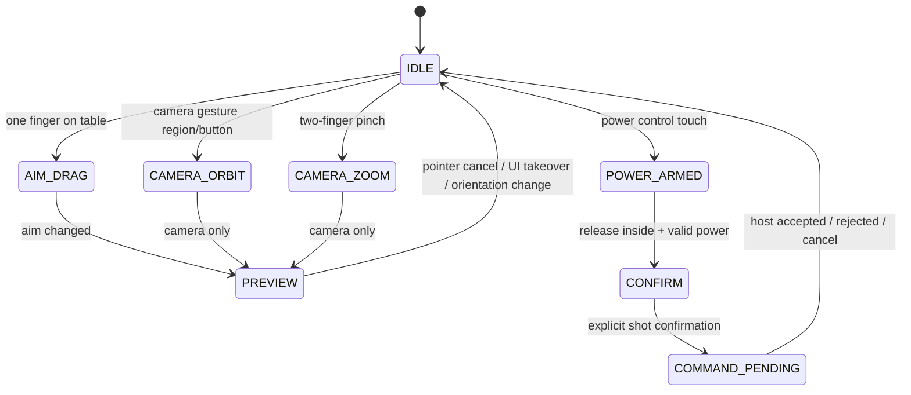

# Android API 37、触控、渲染与生命周期方案

## 1. 目标与当前事实

目标为 Android 17+、`minSdk=targetSdk=compileSdk=37`，优先 GDScript 与 Godot 标准导出；只有已证明必要才引入 Kotlin/Android v2 插件。当前没有 Godot 工程、导出预设、JDK、Gradle、ADB 或 Android SDK，因此本文是目标方案，所有构建和设备结论为 `BLOCKED`。

版本基线：Godot `4.7.2-stable` 与完全匹配的导出模板。Android 官方 API 37 文档要求 `compileSdk=37`、Android Studio Meerkat 2024.3.1+、AGP 至少 8.9.0-rc01，并建议 Build-Tools 37.x；Godot 稳定导出文档同时列出 OpenJDK 17、Platform-Tools 35+、Build-Tools 35.0.1、Platform 35、NDK r28b 与 CMake 版本。**不能用理论合并两份清单替代真实构建**：API 37 Platform/Build-Tools 与 Godot 生成 Gradle wrapper/AGP 的组合必须在 PoC 中读取并记录。

## 2. 工具链和导出顺序

1. 安装 Godot 4.7.2 standard（非 .NET）与同版 export templates，通过插件工具核验实际 binary/capabilities。
2. 安装 OpenJDK 17、Android command-line tools、Platform-Tools、Platform 37、Build-Tools 37.x；保留 Godot 文档要求的 Build-Tools 35.0.1 作为已核验兼容回退，不预先假定需要两个版本同时参与构建。
3. 只有 GDExtension/自定义 Gradle 构建实际需要时安装 NDK `28.1.13356709` 和 CMake `3.10.2.4988404`；若 godot-sqlite 的 Android 导出需要它们，记录依赖链。
4. 让 Godot 4.7.2 生成 Android build 与 Gradle wrapper，读取实际 AGP、Gradle、compile/target SDK、Manifest merger 结果；不猜版本，不先下载系统 Gradle。
5. 先建无游戏功能的导出冒烟场景，导出 debug APK、安装、启动、旋转、后台、权限和网络；再接入 SQLite PoC，最后才是正式功能。
6. Release/AAB、签名和升级测试属于后续发布门禁；签名文件与密码不入库，使用环境变量和本地安全存储。

环境安装与可复现命令见 [环境准备](14-environment-preparation.md)，决策见 [ADR-009](adr/ADR-009-android-api37.md)。

## 3. 权限方案

| 权限/能力 | 用途 | 请求时机与降级 |
|---|---|---|
| `INTERNET` | UDP/ENet socket | 导出声明；不是敏感权限，但不代表 API 37 LAN 已授权 |
| `android.permission.ACCESS_LOCAL_NETWORK` | API 37 target 的 LAN 收发 | Manifest 声明；首次主动进入 LAN 时解释后运行时请求，授权前不开 socket |
| `CHANGE_WIFI_MULTICAST_STATE` | 仅在未来 multicast 方案确有必要时 | 默认广播方案不预先加入；若某些设备广播接收实测需要再 ADR 评审 |
| 震动 | 可选击球反馈 | 使用平台能力并允许关闭；不作为核心输入或规则反馈唯一渠道 |
| 宽泛存储/照片/定位/蓝牙 | 无 | 默认不申请；回放导出优先应用私有目录与系统选择器 |

Android 官方说明 target 37+ 的本地网络保护覆盖 UDP 单播、广播、组播收发，缺失权限时 UDP 可能出现 `EPERM`；只有 `INTERNET` 不够。权限属于 `NEARBY_DEVICES` 组，可能因同组权限已授予而不再次弹窗，因此必须查询真实授权状态而不是“是否弹过窗”。

首选 `OS.request_permission("android.permission.ACCESS_LOCAL_NETWORK")`、导出 custom permissions 与 `MainLoop.on_request_permissions_result` 的真实回调链。请求是异步的；界面保持等待/可取消状态，回调后重新查询权限。用户拒绝、永久拒绝或设置中撤销均停止 LAN、释放 socket，并保留单机模式，不反复弹窗或尝试绕过。

如果 Godot 4.7.2 在 API 37 设备上不能声明/请求该权限，才制作最小 Android v2 插件；插件只提供 `isLocalNetworkGranted/requestLocalNetwork` 和结果信号，不接触比赛规则。系统提供的通用 NSD picker 是另一套发现方案，只有广播+权限路径失败且维护者批准后才评估。

## 4. 横竖屏与自适应布局

Android 17 对 `sw>=600dp` 设备不再允许依赖方向锁定 opt-out，因此不能锁横屏躲避适配。布局由可用窗口尺寸、safe area 和输入能力决定，而不是只看设备“手机/平板”标签。

| 区域 | 横屏 | 竖屏 |
|---|---|---|
| 3D 桌面 | 中央最大化，保留瞄准/镜头空间 | 上部主要区域，允许切换近景/全桌 |
| 球权/球组/叫袋 | 侧栏或可收起面板 | 顶部紧凑状态 + 底部叫袋面板 |
| 力度/击球 | 拇指可达侧下方，明确确认 | 底部主操作区，避免与系统手势冲突 |
| 杆点/旋转 | 侧边弹出控件，打开时锁定瞄准手势 | 底部 sheet，不覆盖关键目标球 |
| 设置/暂停 | safe area 内顶部按钮 | 同左，兼容文字缩放和本地化 |

实现使用 `Control` anchors/containers、约束断点和统一 logical units；3D viewport 按剩余矩形分配。旋转/分屏/折叠变化时取消当前手势、保存意图草稿、重新计算 camera framing 和 safe area，再允许输入，不能把旧屏幕坐标直接映射到新桌面。

最小触控目标初始建议 48 dp 以上、关键操作有间距；字体缩放、超长文本、对比度和色弱不只靠颜色表达球组。具体数值需要设备可用性测试。

## 5. 触控和镜头状态机

- UI 控件优先消费事件；桌面手势只处理 `_unhandled_input`，按 pointer ID 跟踪，不能因第二根手指出现跳变。
- 瞄准、镜头、力度和杆点互不直接写物理；只生成预览或规范命令。击球需要明确确认，防止松手误触。
- 双指缩放使用相对距离变化；旋转和倾斜有独立手势/模式，避免与系统返回手势冲突。边缘区域保留系统手势空间。
- 摄像机使用受限 orbit/dolly 和预设全桌/瞄准/顶部视角；所有平滑只影响表现。布局或比赛状态切换时取消惯性，避免镜头失控。
- 桌面鼠标仅作为开发期同一抽象的输入源，不单独维护另一套规则流程；不能代替真实多点触控测试。

## 6. 生命周期与网络/存储

| 事件 | 必须执行 | 恢复时 |
|---|---|---|
| `application_paused` / 后台 | 禁止新命令，冻结表现/音频，记录最近完整 shot 边界，降低或停止非必要处理 | 重新读取窗口、安全区、权限、网络、音频状态 |
| `application_resumed` | 不补算后台 wall-clock 物理 tick | 从已提交边界继续；LAN 先完成会话/快照恢复 |
| 进程杀死 | 依赖已提交事务，不写“退出时再保存”唯一副本 | 启动校验数据库和快照，恢复或明确报告 |
| 窗口/方向变化 | 取消 pointer、暂停确认、重建布局 | 新坐标下重新预览，旧未提交命令不自动发送 |
| Wi-Fi 变化/权限撤销 | 标记 session 失效、关闭 socket、保留本地比赛 | 新授权/网络下显式重连，不沿用旧 peer ID |
| 低内存/热压力 | 降表现质量、停止非关键效果，保留权威状态 | 稳定窗口后逐步升档，避免频繁振荡 |

SQLite 提交和备份不可因后台回调被半途中止而不报告；使用事务和结构化结果。恢复 LAN 时主机仍是唯一权威，客户端磁盘快照不能覆盖主机。

## 7. 渲染器选型：双路径门禁

官方文档将 Mobile 定位于移动端/Vulkan 等 RenderingDevice 后端，Compatibility 定位于低端和 OpenGL；本项目不采用 Forward+。最终默认渲染器仍未决定，必须同内容、同资源、同设备双构建对比。

### 共同内容约束

- 简单 PBR 球桌/球体、有限实时灯、烘焙静态照明优先；材质、纹理和曝光建立共同基线。
- 避免只有 Forward+ 可用的效果；需要 Mobile 特性时提供 Compatibility 降级，而不是把画面差异当性能优势。
- 球的运动来自同一物理快照，测试回放固定镜头与命令，确保两构建负载可比。

### 对比指标

| 类别 | 记录 |
|---|---|
| 正确性 | 启动、shader 编译、纹理/材质、阴影、袋内遮挡、UI、旋转、后台恢复、无持续渲染错误 |
| 性能 | 冷/热启动、平均与 p95/p99 frame time、1% low、物理 tick 超时、AI 规划、GPU/CPU 可用计数器 |
| 资源 | RSS/可用内存代理、纹理/网格估算、APK/AAB 大小、加载峰值 |
| 稳定性 | 30 分钟 soak、热状态、降频、崩溃/ANR、渲染设备丢失（若可模拟） |
| 视觉 | 同机同分辨率截图与人工检查，不仅凭平均 FPS |

建议最低覆盖一台 Vulkan 较新设备、一台低端/OpenGL 重要设备、一台 sw≥600dp 设备；具体设备未提供前是计划而非已完成矩阵。若 Mobile 不能覆盖最低目标设备，则默认 Compatibility，并将 Mobile 作为可选高质量档；若两者均不达标，降低材质/阴影/分辨率而非伪造通过。

## 8. 画质档和自适应策略

- 低/中/高档只调整表现：渲染比例、阴影分辨率/距离、MSAA、纹理级别、粒子、非关键动画和快照频率；不改变 tick、碰撞、规则、AI 或 LAN 权威。
- 启动根据能力查询选择保守档，用户手动选择优先并持久化。自动降档使用移动窗口 frame time 和热状态迟滞；升档更慢，避免振荡。
- 物理 240 Hz 是初始权威步长，不要求渲染 240 FPS；渲染插值可在 30/60 Hz 工作。低帧率不能通过丢权威 tick “追上”。
- 后台停止非必要渲染/音频与发现广播；LAN 心跳策略必须与系统限制实测，不能承诺长期后台房间保活。

## 9. 最小 PoC 与阻塞清单

| PoC | 前置环境 | 当前状态 | 通过证据 |
|---|---|---|---|
| Godot binary/模板核验 | Godot 4.7.2 与模板 | BLOCKED | doctor/capabilities、模板路径与版本 |
| 最小 Android APK | JDK 17、SDK、Gradle wrapper、设备 | BLOCKED | 构建命令、APK hash、安装和启动日志 |
| API 37 LAN 权限 | API 37 真机/模拟器、ADB | BLOCKED | 允许/拒绝/撤销下 UDP 收发与回调日志 |
| SQLite Android | 上两项 + v4.9 固定资产 | BLOCKED | arm64 加载、CRUD、事务、迁移、备份日志 |
| Mobile/Compatibility | 双构建 + 设备矩阵 | BLOCKED | 同内容指标、截图、日志和最终 ADR 更新 |
| 横竖屏/触控/生命周期 | API 37 与大屏设备 | BLOCKED | 输入轨迹、旋转/后台/进程恢复记录 |

本阶段没有安装工具或创建 Android 工程，不能用文档检查替代上述验证。
