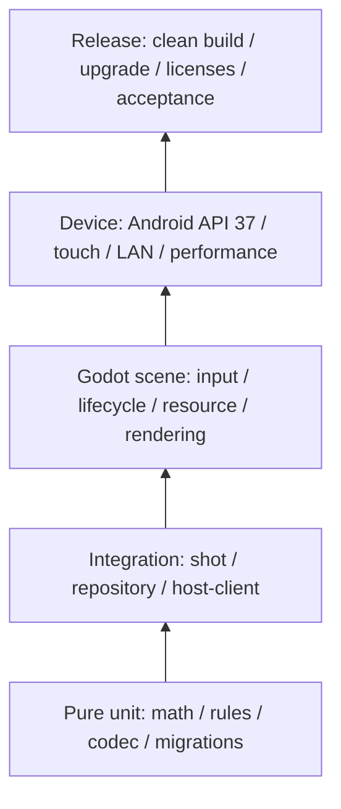

# 性能预算、测试策略与诊断

## 1. 证据口径

以下数值是阶段 2/后续用于验收的**初始预算假设**，不是测得结果。任何 `PASS` 必须附实际版本、设备、分辨率、画质、命令、样本时长和原始日志；桌面结果不能替代 Android，平均 FPS 不能替代帧时间分布。

## 2. 初始性能预算

| 领域 | 中档目标设备预算 | 低档降级预算 | 备注 |
|---|---|---|---|
| 渲染 | 60 FPS 目标；p95 frame time ≤16.7 ms，p99 ≤33.3 ms | 稳定 30 FPS；p95 ≤33.3 ms | 固定回放、静止与开球分别测量 |
| 权威物理 | 240 tick/s；常规 tick p95 ≤2 ms，重接触 tick 不持续超过 4.167 ms | 同一步长，不能降权威频率 | 超出工作保留到后续帧并记录，不丢 tick |
| 单帧追赶 | 最多 16 tick，超出显示模拟落后于实时的诊断 | 同左 | 回合制不补后台 wall-clock |
| 输入 | 触控到可见预览 p95 ≤100 ms | p95 ≤150 ms | 不含网络主机往返；网络另测 |
| LAN 控制 | 正常 LAN 命令到接受/拒绝 p95 ≤250 ms | 弱网报告分布，不伪造阈值通过 | 需双设备时间同步方法或主机时间戳 |
| AI | 规划期间 UI 保持响应；无主线程长阻塞 | 减少 rollout 数/画质，不阻塞输入 | 计算预算按候选，不用 wall-clock 改结果 |
| 存储 | shot 事务不造成可感知长卡顿；耗时全量记录 | 同左 | p50/p95/p99、最大值和失败均记录 |
| 内存 | 初始峰值目标 ≤512 MiB，30 分钟无持续增长 | 初始峰值目标 ≤384 MiB | 待设备分级修订；Godot/OS 指标口径需注明 |
| 稳定性 | 30 分钟对局/LAN soak 无崩溃、ANR、权威分歧 | 同左 | 发布前延长，30 分钟不是完整 soak 验收 |

预算未覆盖的启动时间、包体、温度和耗电在首个设备基线后设阈值。不得为了“达到 60 FPS”改变物理、规则、AI 结果或客户端权威边界。

## 3. 测试金字塔



| 层 | 范围 | 关键断言 |
|---|---|---|
| 纯单元 | DTO、TOI、冲量、摩擦、规则 reducer、AI seed、codec | 无场景树/I/O，固定 fixture，边界和性质断言 |
| 集成 | MatchController、物理→规则→事务、重连、快照恢复 | 事件顺序、幂等、回滚、完整 shot 边界 |
| Godot headless | 导入、脚本、场景、资源、测试 runner | 真实引擎错误码/日志，不把 headless 当渲染验收 |
| 渲染/交互 | 双渲染器、UI、镜头、手势、方向 | 截图、结构回读、真实输入轨迹 |
| Android 设备 | 权限、SQLite、LAN、生命周期、性能、升级 | API 37 实机为主，模拟器仅补充 |
| 发布 | 干净 checkout、锁定依赖、APK/AAB、签名和归属 | 可复现命令、hash、许可证、安装/升级证据 |

测试 runner 首选 Godot 4.7.2 可 headless 执行的轻量项目内 runner（入口 `extends SceneTree`）与 Python 静态/模型探针；不为了测试再引入未审查框架。若后续选择 GdUnit4/GUT，必须补来源、版本、许可证、4.7.2 兼容证据和维护状态 ADR。

## 4. 分领域必测矩阵

| 领域 | 自动化 | 场景/设备 | 失败处理 |
|---|---|---|---|
| 物理 | 正/斜/连续碰撞、守恒特例、TOI、滑动滚动、睡眠、快照 hash | 开球、贴库、六袋 jaw、极高速、不同渲染 FPS | 保存输入/seed/tick/事件，技术错误而非猜结果 |
| 规则 | 第 4 文档全部 RULE 用例、重复/乱序事件、属性测试 | 完整对局和人工核对典型争议 | reducer 不迁移非法状态 |
| AI | 合法性、复现、无权写状态、候选失败、难度分布 | 固定 layout 集、人机体验、移动耗时 | 明确无候选/取消，不作弊 |
| 网络 | codec fuzz、身份、限流、幂等、乱序/丢包/重连 | 双进程和双 Android 设备、Wi-Fi 切换 | 拒绝、重同步或结束，不客户端裁决 |
| SQLite | CRUD、外键、事务、迁移、唯一键、备份、损坏 | Android 升级、进程杀死、磁盘不足 | 回滚、隔离、已校验备份，不静默清空 |
| 回放 | 规范编解码、hash、版本、截断/恶意大小、快照路径 | 长回放 seek、跨版本元数据路径 | 分歧停止并报告，不继续伪播放 |
| UI/输入 | 手势状态、pointer cancel、坐标转换、safe area 纯逻辑 | 横竖屏、分屏、折叠、文字缩放、系统手势 | 取消旧手势，不自动击球 |
| Android | Manifest/权限静态检查、导出、安装升级 | 权限拒绝/撤销、后台、网络变化、低内存 | 离线降级或明确不可用 |
| 渲染/性能 | 可复现基准和资源预算 | Mobile/Compatibility 同内容、热 soak | 降表现档，记录未达标设备 |

## 5. 复现与属性测试

- 固定 fixture 包含完整版本集、配置、初始球态、命令、seed、预期事件和 hash；测试失败将最小 fixture 写入用户选择的诊断目录。
- 每次运行记录随机 seed；失败可通过 seed 重放。属性测试检查动量/能量特例、无 NaN、球组互补、schema 不变量、codec round-trip，不以随机测试替代固定规则样例。
- 渲染帧率用可控 30/60/120 Hz 输入比较权威 tick/hash；跨 CPU 只报告实际观察，不预定位级一致。
- 网络故障注入位于传输适配器，不修改 ENet 库；覆盖 delay/loss/duplicate/reorder/disconnect。可靠通道表现以最终结果为准。
- 数据库故障通过 repository fault-injection 接口模拟，不通过删除真实用户文件测试。

## 6. 日志设计

结构化 JSON Lines 字段：

```text
timestamp_utc, monotonic_ms, level, event, app_version, engine_version
session_id_hash, match_id, turn_serial, shot_serial, tick, peer_alias
state_revision, config_hashes, error_code, duration_ms, details
```

- 默认级别 INFO；物理逐 tick TRACE 仅在诊断构建显式开启并限长，避免改变时序。
- 不记录房间码、reconnect token、签名密码、完整 IP、昵称全文或数据库内容；标识使用带进程随机盐的 hash，诊断导出前提示用户。
- 本地日志位于 `user://logs/`，按大小轮转，初始建议 5×2 MiB，待实测调整；崩溃/技术错误另保存小型上下文包。
- 性能测量使用单调时钟；wall clock 只用于展示。主线程/存储/worker 分别标记，避免把异步等待算作 SQL 时间。
- 网络日志记录 message type、长度、序列和错误，不记录原始敏感 payload；开启 packet capture 需要明确诊断模式。

## 7. 崩溃与技术错误诊断

诊断包包含：版本集、平台/设备匿名能力、最近完整 shot 元数据、配置 hash、seed、最近有界事件、错误码、日志索引和构建 hash；不包含签名材料、完整数据库或 token。

Godot/GDScript 错误由结构化错误返回、engine stdout/stderr 和应用日志收集；Android 同时保留 `adb logcat` 与应用版本/设备信息。GDExtension native crash 可能绕过 GDScript，因此 SQLite PoC 必须验证崩溃日志可获取；发布符号与原生 tombstone 的处理在工具链可用后补充，不能承诺已有自动 crash reporter。

严重物理不收敛、hash 分歧、数据库损坏和恢复失败提供可复制诊断 ID；用户可主动导出。无账号、无默认网络上传。

## 8. 性能实验方法

1. 固定构建、设备、OS、分辨率、渲染器、画质、温度和电源状态，先冷启动再预热。
2. 使用同一版本化回放运行静止、普通击球、开球多接触、AI 高负载、LAN 和回放读取场景。
3. 每个场景记录足够样本与 p50/p95/p99/max，保留原始 JSON；同时记录物理 backlog 和 SQL 时间，避免只测 GPU。
4. Mobile/Compatibility 同机先后测试并交错顺序，减少热漂移；报告是否充电、是否降频。
5. 30 分钟 soak 观察内存趋势、日志错误、ANR、LAN 重连和数据库大小；设备不足时明确未覆盖。

## 9. 当前验证状态

本阶段仅 Python 数学、SQL 草案、文档链接和 Git 静态检查可执行。Godot 测试 runner、GDScript、导入、网络、渲染、Android 导出、设备性能、发热、耗电、崩溃和升级均 `BLOCKED`；正式发布级长时间 QA 为本阶段范围外的 `NOT RUN`，详见 [验证报告](13-validation-report.md)。
